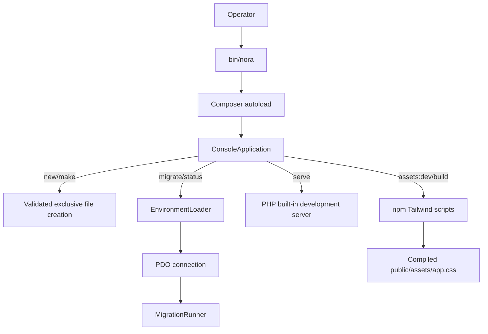

# CLI Architecture

`bin/nora` loads Composer autoloading and dispatches arguments to
`ConsoleApplication`. Commands are implemented in that class and return a
process exit code.

Implemented commands:

- `--help`, `--version`
- `new <name>`: creates a new project only if the destination does not exist;
  generated Composer metadata uses a local path repository to the creating
  Nora checkout. Generated application classes and `.nora` templates live
  under `src/`; Composer maps `App\` to that directory, and `src/routes.php`
  explicitly registers route handlers.
- `make:controller <name>`, `make:model <name>`, and
  `make:middleware <name>`: validate class names and exclusively create
  files under fixed source directories. Generated controllers are callable
  route handlers; middleware implements Nora's pass-through contract.
  Models are plain classes and are not an ORM abstraction.
- `make:component <name>`: creates a reactive page component under
  `src/Reactive`.
- `make:view <name>`: creates an escaped-interpolation `.nora` template under
  `src/Views`.
- `make:service <name>`: creates a plain class under `src/Services`; the
  application instantiates it explicitly because Nora has no service
  container.
- `make:test <name>`: creates a PHPUnit feature test under `tests/Feature`.
  New scaffolds include PHPUnit as a development dependency and provide a
  route test for `/welcome`.
- `tailwind:init`: add Tailwind CSS v4 source and Nora-namespaced npm scripts
  without overwriting an existing stylesheet or conflicting script.
- `assets:dev`, `assets:build`, and `assets:check`: run the configured npm
  build/watch commands or validate the v4 source configuration and production
  output.
- `migrate` and `migrate:status`: load `.env`, require `NORA_DSN`, connect via
  PDO, and run/report migrations. Database availability is required.
- `serve [host] [port]`: starts PHP's built-in development server for a
  generated application. Host must be an IP and port must be in range.

There are no advertised placeholder commands. The built-in web server is not
for production. Scaffolds are tied to the local path of the Nora checkout
until the package is published or otherwise distributed.
New scaffolds include Tailwind CSS v4 dependencies and a source stylesheet
that scans only `src/`; the initializer for existing apps also scans
`views/` and `templates/`. Asset scripts delegate to the npm-installed
official Tailwind CLI. They do not download packages or edit generated output
during a production request.

